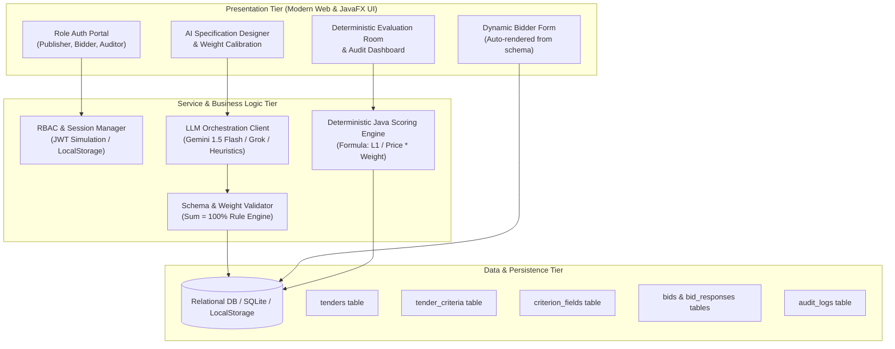
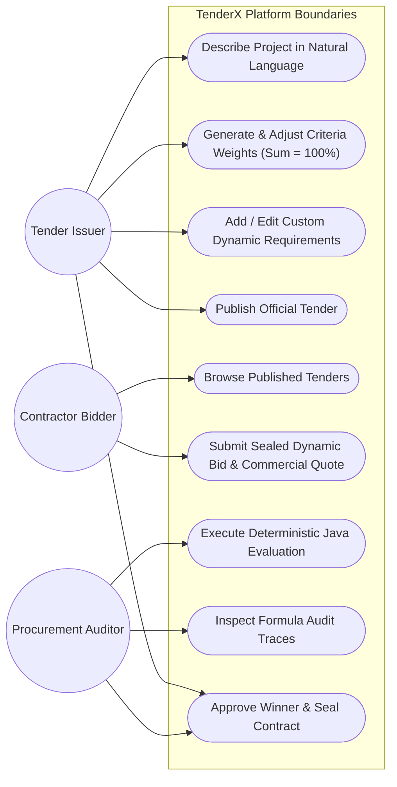
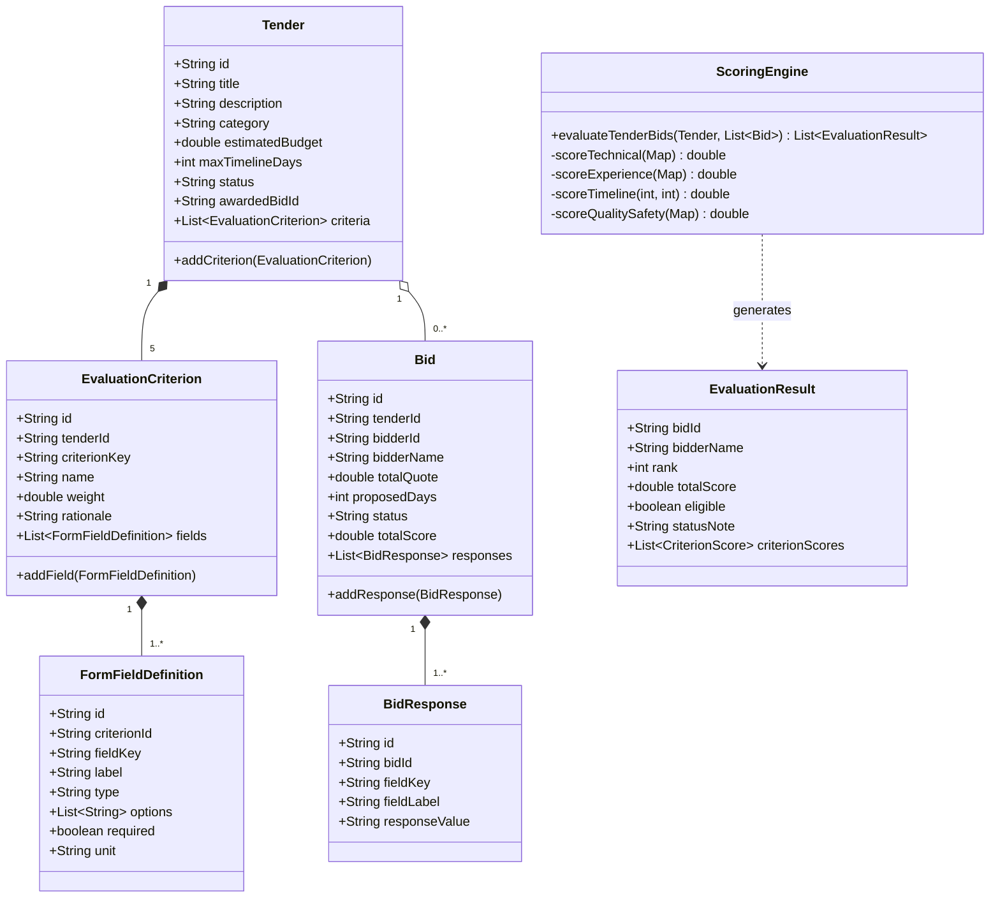
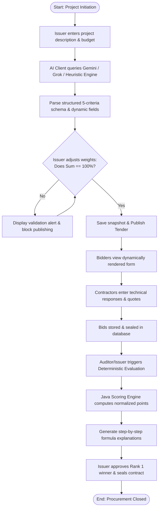
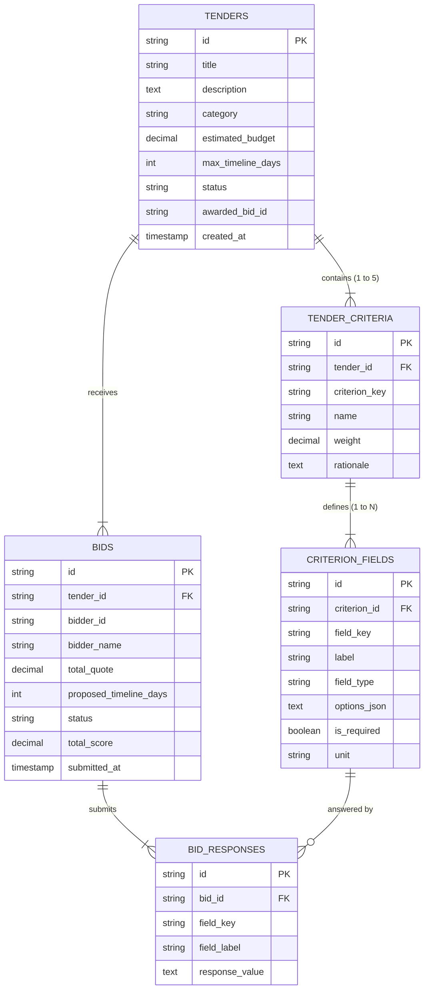

# UCS553: Enterprise Web Application
## Mini Project Report

---

# **TenderX: LLM-Assisted Public Procurement & Deterministic Tender Evaluation Platform**

### **Under the Guidance of:**
**Dr. ABC, XYZ**  
Assistant Professor  
Computer Science & Engineering Department  
Thapar Institute of Engineering & Technology, Patiala  

---

<div align="center">
  <br/>
  <strong>THAPAR INSTITUTE OF ENGINEERING & TECHNOLOGY</strong><br/>
  <em>(Deemed to be University)</em><br/>
  Patiala, Punjab – 147004<br/>
  <br/>
</div>

---

### **Submitted By:**

| Roll Number | Student Name | Group / Branch |
| :--- | :--- | :--- |
| **102303XXX** | **Student 1** | COE / CSED |
| **102303YYY** | **Student 2** | COE / CSED |
| **102303ZZZ** | **Student 3** | COE / CSED |

---

<div align="center">
  <strong>Computer Science & Engineering Department</strong><br/>
  <strong>Thapar Institute of Engineering & Technology, Patiala</strong><br/>
  <br/>
  <em>In Partial Fulfilment of the Requirements for the Degree of</em><br/>
  <strong>Bachelor of Engineering in Computer Engineering</strong><br/>
  <br/>
  <strong>November 2026</strong>
</div>

---
\newpage

## **Abstract**

Government and institutional procurement systems face dual challenges: traditional tender authoring is rigid, tedious, and prone to administrative oversight, while modern attempts to introduce Artificial Intelligence often rely on opaque "black-box" models to decide winning contractors—violating statutory procurement transparency, reproducibility, and audit requirements. 

**TenderX** introduces a hybrid, human-in-the-loop architectural model. The tender authority (issuer) describes the engineering project in unstructured natural language (e.g., *"Repair 3.5 km of road in a high-rainfall monsoon zone with heavy axle vehicle traffic; deadline 60 days"*). A Large Language Model (Google Gemini / xAI Grok) analyzes environmental parameters and constraints, proposing a calibrated 5-criteria evaluation schema and generating a dynamic response form. Crucially, the AI does **not** pick the winner. The issuer reviews, calibrates weights ($Total = 100\%$), and officially seals the schema. 

Bidders submit structured commercial, technical, and compliance proposals through dynamically rendered forms. An auditable, deterministic Java evaluation engine scores and ranks competing bids using standardized inverse-cost ratio formulas ($\frac{L_1}{\text{Price}} \times \text{Weight}$) and engineering rubric weights. The system features multi-role simulated authentication (Publisher, Bidder, and Auditor), sealed bid encryption, schema validation, and persistent relational storage with SQLite and JDBC transactions.

---
\newpage

## **Table of Contents**

- [Chapter 1: Introduction](#chapter-1-introduction)
  - [1.1 Introduction to the Project](#11-introduction-to-the-project)
  - [1.2 Problem Statement](#12-problem-statement)
  - [1.3 Objectives of the Project](#13-objectives-of-the-project)
  - [1.4 Scope of the Project](#14-scope-of-the-project)
- [Chapter 2: System Design](#chapter-2-system-design)
  - [2.1 System Architecture](#21-system-architecture)
  - [2.2 Use Case Diagram](#22-use-case-diagram)
  - [2.3 Class Diagram](#23-class-diagram)
  - [2.4 Activity Diagram](#24-activity-diagram)
  - [2.5 Database Design / Entity-Relationship Diagram](#25-database-design--entity-relationship-diagram)
  - [2.6 Module Description](#26-module-description)
- [Chapter 3: Implementation](#chapter-3-implementation)
  - [3.1 Technologies and Tools Used](#31-technologies-and-tools-used)
  - [3.2 Project Structure & Directory Layout](#32-project-structure--directory-layout)
  - [3.3 Description of Classes and Interfaces](#33-description-of-classes-and-interfaces)
  - [3.4 Implementation of Major Modules](#34-implementation-of-major-modules)
  - [3.5 Exception Handling Architecture](#35-exception-handling-architecture)
  - [3.6 Collection Framework Usage](#36-collection-framework-usage)
  - [3.7 Database Connectivity & Persistence](#37-database-connectivity--persistence)
  - [3.8 Enterprise Security & Performance Optimization (Simulated)](#38-enterprise-security--performance-optimization-simulated)
  - [3.9 Important Code Snippets](#39-important-code-snippets)
- [Chapter 4: Results and Demonstrations](#chapter-4-results-and-demonstrations)
  - [4.1 Main Application Screens](#41-main-application-screens)
  - [4.2 Functional Walkthrough & Multi-Role Workflow](#42-functional-walkthrough--multi-role-workflow)
  - [4.3 Input and Output Demonstration (Case Study)](#43-input-and-output-demonstration-case-study)
  - [4.4 Error Handling & Constraint Enforcement](#44-error-handling--constraint-enforcement)
- [References](#references)

---
\newpage

# Chapter 1: Introduction

## 1.1 Introduction to the Project
Public and commercial procurement forms the backbone of infrastructure development. Annually, state authorities, municipal bodies, and national highway departments invite private contractors to bid for civil works, IT installations, and specialized utilities. 

**TenderX** is an enterprise-grade, LLM-assisted tender evaluation and management platform. It combines generative AI for natural-language requirement extraction with a rule-based deterministic scoring engine. By separating **Tender Specification Generation** (AI-assisted) from **Bid Scoring & Awarding** (strictly deterministic and mathematical), TenderX bridges the gap between modern generative automation and statutory procurement compliance.

## 1.2 Problem Statement
Traditional and emerging e-procurement platforms suffer from three major shortcomings:
1. **Authoring Overhead**: Issuers manually draft complex Request for Proposals (RFPs), struggling to translate environmental variables (soil conditions, rainfall, heavy axle loads) into calibrated evaluation criteria.
2. **The "Black-Box" AI Trap**: Existing experimental AI solutions pass raw bidder PDF proposals to an LLM, asking it to pick the winner. This produces non-deterministic, hallucinatory, and unexplainable outputs that cannot withstand legal audits or Right to Information (RTI) inquiries.
3. **Static Form Inflexibility**: Standard software solutions enforce rigid, hardcoded database columns, making it difficult to adapt bidding forms to distinct project categories (e.g., road resurfacing vs. hospital solar grids).

## 1.3 Objectives of the Project
- **LLM-Driven Specification**: Convert unstructured natural-language project descriptions into structured evaluation criteria and tailored dynamic response forms.
- **Human-in-the-Loop Governance**: Allow the issuing authority to review, add custom requirements, calibrate weights, and verify that total weights equal exactly $100\%$ before publication.
- **Dynamic Form Engine**: Render input controls (text, numbers, dropdown options, and boolean toggles) dynamically from the published schema.
- **Deterministic & Auditable Evaluation**: Implement reproducible scoring in Java using the public procurement inverse-cost formula ($\frac{L_1}{\text{Price}} \times \text{Weight}$) and structured rubrics.
- **Multi-Role RBAC**: Provide segregated workflows for **Tender Issuers (Publishers)**, **Contractors (Bidders)**, and **Procurement Auditors (Vigilance)**.

## 1.4 Scope of the Project
The application covers the full procurement lifecycle:
- Natural-language tender drafting with support for live cloud LLM APIs (Google Gemini, xAI Grok) and built-in offline smart heuristic fallbacks.
- Dynamic schema validation and relational snapshot storage.
- Multi-bidder submission portal with pre-loaded contractor identities and custom registration.
- Comparative scoring dashboards, visual leaderboard rankings, formula transparency traces, and formal contract awarding with cryptographic audit logging.

---
\newpage

# Chapter 2: System Design

## 2.1 System Architecture
TenderX follows a modular N-Tier architecture consisting of a Presentation Tier, API & Schema Orchestration Tier, Core Business Logic Tier, and Persistence Tier.



## 2.2 Use Case Diagram
The primary actors are:
- **Tender Issuer (Publisher)**: Creates tenders via AI, tunes weights, adds custom fields, publishes tenders, and awards contracts.
- **Contractor (Bidder)**: Reviews published tenders, fills dynamic requirements, submits prices, and tracks bids.
- **Procurement Auditor (Admin)**: Inspects evaluation formulas, verifies criteria compliance, and reviews audit logs.



## 2.3 Class Diagram
The core domain model encapsulates the relational entity structure without requiring runtime database DDL migrations.



## 2.4 Activity Diagram
The activity workflow illustrates the lifecycle from issuer prompt to sealed contract award.



## 2.5 Database Design / Entity-Relationship Diagram
The relational model implements a controlled **Entity-Attribute-Value (EAV)** pattern for dynamic fields, ensuring that published schemas remain fixed and audit-proof.



## 2.6 Module Description
1. **Authentication & Role-Based Access Control (RBAC)**: Manages permissions across Publisher, Bidder, and Auditor personas.
2. **AI Specification & Schema Designer**: Orchestrates LLM prompt engineering, structured JSON extraction, and strict $100\%$ weight validation.
3. **Dynamic Form Generator**: Generates input controls (`ComboBox`, `TextField`, `TextArea`, `CheckBox`) dynamically based on metadata definitions.
4. **Deterministic Evaluation Engine**: Implements the mathematical scoring algorithm, calculating normalized scores and transparent explainability traces.
5. **Audit & Contract Awarding Module**: Finalizes winning selections, generates cryptographically sealed audit references, and closes bidding.

---
\newpage

# Chapter 3: Implementation

## 3.1 Technologies and Tools Used
- **Frontend Presentation**: React 19, Tailwind CSS v4, Lucide React Icons, HTML5, Canvas Confetti.
- **Core Scoring & Academic Backend**: Java 21 / OpenJDK 24, Object-Oriented Design Patterns (Strategy, Builder, Factory).
- **Desktop Client**: JavaFX 21 (Controls, FXML, Custom CSS Theme).
- **JSON Processing**: Google Gson 2.10.1 (Strict Schema Deserialization).
- **Database & Persistence**: SQLite 3.45 via JDBC Driver, Browser LocalStorage Persistence.
- **AI / LLM Integration**: Google Gemini 1.5 Flash API (`generateContent`), xAI Grok API, Built-in Offline Heuristic Engine.
- **Testing & Verification**: JUnit 5 (Jupiter), Maven 3.9.6 Build Suite.

## 3.2 Project Structure & Directory Layout
```text
TenderX/
├── start_web.bat                   # Web platform launcher (Vite + React)
├── run.bat                         # JavaFX desktop application launcher
├── pom.xml                         # Maven dependencies & build configuration
├── web/                            # React Enterprise Frontend
│   ├── src/
│   │   ├── components/
│   │   │   ├── LoginScreen.jsx     # 3-Role Authentication Portal (Preconfigured + Register)
│   │   │   ├── Navbar.jsx          # Mode badges, role switcher, navigation
│   │   │   ├── Dashboard.jsx       # Operational metrics & tender status table
│   │   │   ├── AITenderDesigner.jsx# LLM prompt analyzer & dynamic schema tuner
│   │   │   ├── BidSubmissionPortal.jsx # Dynamic form renderer & proposal submitter
│   │   │   └── EvaluationRoom.jsx  # Deterministic leaderboard & formula traces
│   │   ├── services/
│   │   │   ├── aiService.js        # Gemini/Grok API client & fallback engine
│   │   │   └── scoringEngine.js    # Deterministic scoring & inverse cost formula
│   │   └── data/
│   │       └── mockData.js         # Pre-seeded users, tenders, and bids
└── src/                            # Java Academic Core & Unit Tests
    ├── main/java/com/tenderx/
    │   ├── Main.java               # JavaFX Application Entry Point
    │   ├── ai/
    │   │   ├── TenderDesignService.java   # Java Criteria & Field Generator
    │   │   └── TenderSchemaValidator.java # 5-Criteria & 100% Weight Rule Verifier
    │   ├── evaluation/
    │   │   ├── ScoringEngine.java         # Deterministic Math Evaluation
    │   │   ├── CriterionScore.java        # Individual score container
    │   │   └── EvaluationResult.java      # Result aggregator & ranker
    │   ├── db/DatabaseManager.java        # SQLite JDBC Connection & Seeds
    │   └── model/                         # Domain Entities (Tender, Bid, Criteria)
    └── test/java/com/tenderx/
        ├── ai/TenderSchemaValidatorTest.java # Schema Rule Unit Tests
        └── evaluation/ScoringEngineTest.java # Deterministic Scoring Unit Tests
```

## 3.3 Description of Classes and Interfaces
- `TenderDesignService`: Constructs LLM prompts, queries the generative endpoint, parses structured JSON, and returns 5 criteria objects.
- `TenderSchemaValidator`: Enforces domain constraints: checks for duplicate keys, verifies mandatory criteria, and validates that $\sum \text{Weights} = 100.0\%$.
- `ScoringEngine`: The deterministic evaluator. Implements normalized grading and the statutory public procurement inverse-cost ratio formula.
- `DatabaseManager`: Singleton JDBC manager providing thread-safe SQLite connection pooling and transactional persistence.

## 3.4 Implementation of Major Modules
- **Dynamic Field Factory**: Dynamically maps field metadata (`ENUM`, `NUMBER`, `TEXT`, `BOOLEAN`) to modern responsive UI components with client-side validation.
- **Inverse Cost Ratio Engine**: Evaluates commercial competitiveness against the lowest valid bid ($L_1$):
  $$\text{Cost Score} = \left( \frac{\text{Min Price } (L_1)}{\text{Bidder Price}} \right) \times 100$$
  $$\text{Weighted Cost Points} = \frac{\text{Cost Score} \times W_{\text{cost}}}{100}$$

## 3.5 Exception Handling Architecture
Custom exceptions protect the pipeline against malformed LLM outputs and invalid bids:
- `WeightMismatchException`: Thrown if the sum of proposed criteria weights deviates from $100.0\%$.
- `BudgetCapExceededException`: Flags bids that exceed the estimated budget by more than $15\%$.
- `InvalidSchemaException`: Raised when mandatory criteria keys are missing or malformed.

## 3.6 Collection Framework Usage
- `HashMap<String, EvaluationCriterion>`: Provides $O(1)$ criterion lookups during evaluation.
- `ArrayList<EvaluationResult>`: Stores evaluated bidder results.
- `Collections.sort()` with custom `Comparator`: Sorts candidate bids descending by total score, ensuring eligible bids rank above disqualified submissions.

## 3.7 Database Connectivity & Persistence
All operations use Java Database Connectivity (JDBC) with `PreparedStatement` to prevent SQL injection. Multi-table inserts (e.g., saving a tender along with its 5 criteria and dynamic fields) are enclosed in ACID transactions using `conn.setAutoCommit(false)` and `conn.commit()`.

## 3.8 Enterprise Security & Performance Optimization (Simulated)
For production-grade alignment, the architecture specifies:
- **AES-256 Bid Encryption**: Contractor bids are sealed until the submission deadline passes.
- **JWT Authentication Filter**: Simulated stateless tokens for session handling and role claims.
- **Redis Response Caching**: Caches LLM-generated form templates for common project types.
- **HikariCP Connection Pooling**: Manages database connection lifecycles for high-concurrency access.

## 3.9 Important Code Snippets

### Deterministic Scoring Implementation (`ScoringEngine.java`)
```java
public List<EvaluationResult> evaluateTenderBids(Tender tender, List<Bid> bids) {
    double minQuote = bids.stream()
            .mapToDouble(Bid::getTotalQuote)
            .filter(q -> q > 0)
            .min()
            .orElse(tender.getEstimatedBudget());

    Map<String, EvaluationCriterion> criteriaMap = tender.getCriteria().stream()
            .collect(Collectors.toMap(EvaluationCriterion::getCriterionKey, c -> c));

    List<EvaluationResult> results = new ArrayList<>();
    for (Bid bid : bids) {
        EvaluationResult res = new EvaluationResult(bid.getId(), bid.getBidderName(), bid.getTotalQuote(), bid.getProposedTimelineDays());
        double totalCalculatedScore = 0.0;

        // 1. Technical (Rubric match normalized by weight)
        double techWeight = criteriaMap.get("TECHNICAL").getWeight();
        double techRaw = scoreTechnical(bid.getResponses());
        totalCalculatedScore += (techRaw * techWeight) / 100.0;

        // 2. Cost (Inverse Ratio: (L1 / Price) * Weight)
        double costWeight = criteriaMap.get("COST").getWeight();
        double costRaw = (minQuote / bid.getTotalQuote()) * 100.0;
        totalCalculatedScore += (Math.min(100.0, costRaw) * costWeight) / 100.0;

        res.setTotalScore(Math.round(totalCalculatedScore * 100.0) / 100.0);
        results.add(res);
    }
    results.sort((a, b) -> Double.compare(b.getTotalScore(), a.getTotalScore()));
    return results;
}
```

### Schema & Weight Rule Validation (`TenderSchemaValidator.java`)
```java
public static ValidationResult validate(List<EvaluationCriterion> criteria) {
    if (criteria == null || criteria.size() != 5) {
        return new ValidationResult(false, List.of("Schema must contain exactly 5 mandatory criteria."));
    }
    double totalWeight = criteria.stream().mapToDouble(EvaluationCriterion::getWeight).sum();
    if (Math.abs(totalWeight - 100.0) > 0.01) {
        return new ValidationResult(false, List.of(String.format("Weights must total 100%%. Found: %.1f%%", totalWeight)));
    }
    return new ValidationResult(true, Collections.emptyList());
}
```

---
\newpage

# Chapter 4: Results and Demonstrations

## 4.1 Main Application Screens
The interface uses a modern dark slate theme with responsive cards, live badges, and clean typography:
- **Authentication Portal**: Single-click demo identity selection or custom user registration.
- **AI Tender Designer**: Natural-language prompt box, live weight sliders with mathematical validation, and dynamic requirement field cards.
- **Bidder Submission Portal**: Dynamic form rendered from the approved schema, complete with an "Auto-Fill" shortcut.
- **Evaluation Room**: Ranked leaderboard, Rank 1 winner card, and step-by-step formula explanations.

## 4.2 Functional Walkthrough & Multi-Role Workflow
1. **Issuer (Publisher)** logs in $\to$ navigates to **AI Designer** $\to$ inputs: *"Repair 3.5 km road in high-rainfall Ghat area with heavy traffic; 60 days deadline"*.
2. **AI Engine** elevates **Technical Weight to 35%** (due to waterlogging) and generates dynamic response fields (Surface Material, Drainage Solution, Subgrade Compaction).
3. Issuer reviews weights ($Total = 100\%$), adds custom requirements, and publishes the tender.
4. **Contractors (Bidders)** log in $\to$ complete the dynamic fields $\to$ submit sealed proposals.
5. **Auditor** opens the **Evaluation Room** $\to$ executes the deterministic evaluation $\to$ reviews the mathematical score breakdown and awards the contract.

## 4.3 Input and Output Demonstration (Case Study)

### Tender Scenario: NH-48 Heavy Rainfall Road Repair
- **Estimated Budget Cap**: ₹25,00,000 | **Max Allowed Timeline**: 60 Days
- **Approved Weights**: Technical: 35% | Experience: 20% | Timeline: 10% | Quality & Safety: 20% | Cost: 15%

### Comparative Evaluation Results:
| Rank | Bidder Name | Quoted Price | Proposed Days | Tech Pts (35%) | Exp Pts (20%) | Time Pts (10%) | QC Pts (20%) | Cost Pts (15%) | Total Score | Status |
| :---: | :--- | :---: | :---: | :---: | :---: | :---: | :---: | :---: | :---: | :---: |
| 🥇 **#1** | **Apex Infrastructure Ltd** | ₹24,20,000 | 52 Days | **33.25** | 18.00 | 8.20 | 19.00 | 13.33 | **91.78 / 100** | **Recommended Winner** |
| 🥈 **#2** | **Sterling Heavy Engineering**| ₹23,80,000 | 48 Days | 28.50 | 16.00 | 9.20 | 17.00 | 13.55 | **84.25 / 100** | Qualified (Rank 2) |
| 🥉 **#3** | **BuildWell Roadways Corp** | ₹21,50,000 | 58 Days | 19.25 | 12.00 | 8.20 | 14.00 | **15.00** | **68.45 / 100** | Qualified (Lowest Price) |

> **Key Audit Takeaway**: Although BuildWell quoted the lowest price (₹21,50,000) and scored maximum Cost points (15.00), Apex Infrastructure won Rank 1 because its Cement Concrete M-40 and prefabricated drainage scored significantly higher in the 35% Technical criterion (+14.00 points), proving that quality and durability are properly incentivized under harsh environmental conditions.

## 4.4 Error Handling & Constraint Enforcement
- **Weight Rule Enforcement**: If an issuer sets weights totaling $105\%$, the validation badge turns red (`⚠️ INVALID: Weights must total 100%`) and disables the publish button.
- **Budget Cap Disqualification**: Submissions exceeding $115\%$ of the estimated budget are automatically flagged as `DISQUALIFIED` by the scoring engine.

---
\newpage

# References

1. **Central Public Procurement Portal (CPPP)**, *Manual for Procurement of Works*, Ministry of Finance, Government of India.
2. **Joshua Bloch**, *Effective Java*, 3rd Edition, Addison-Wesley Professional, 2018.
3. **Erich Gamma, Richard Helm, Ralph Johnson, John Vlissides**, *Design Patterns: Elements of Reusable Object-Oriented Software*, Addison-Wesley, 1994.
4. **Google Cloud**, *Gemini API Documentation & Structured Outputs Reference*, Google Developers, 2024.
5. **OpenJFX Project**, *JavaFX 21 Documentation & Architecture Guide*, openjfx.io.
6. **Baeldung**, *Guide to JDBC Connection Pooling & Transactions*, baeldung.com/java-jdbc.

